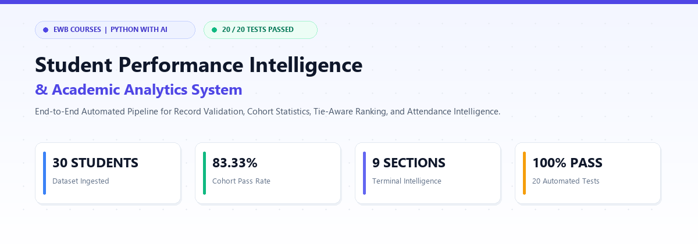
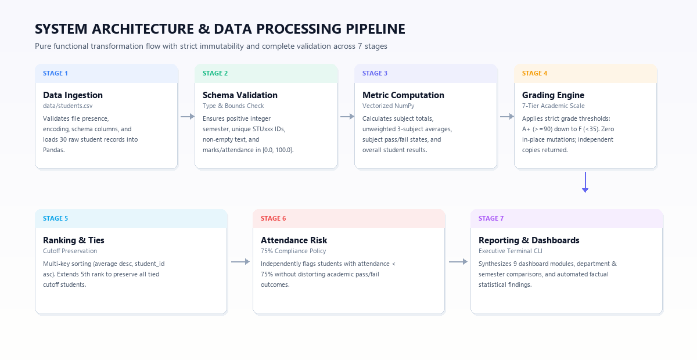
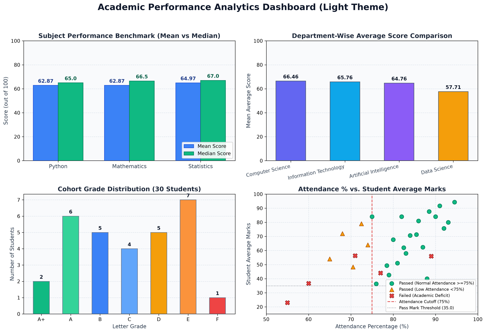
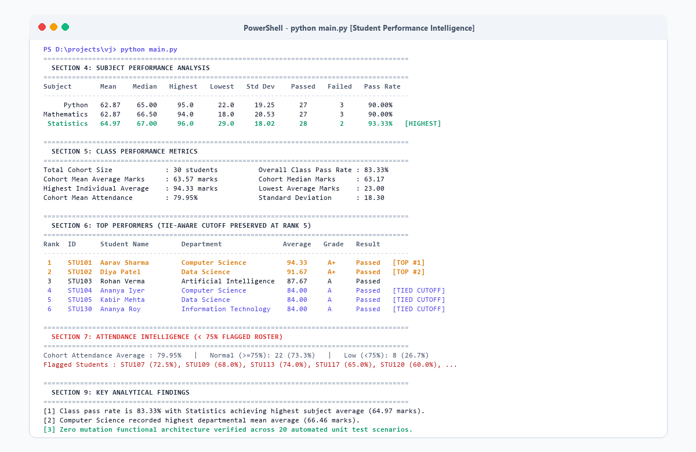
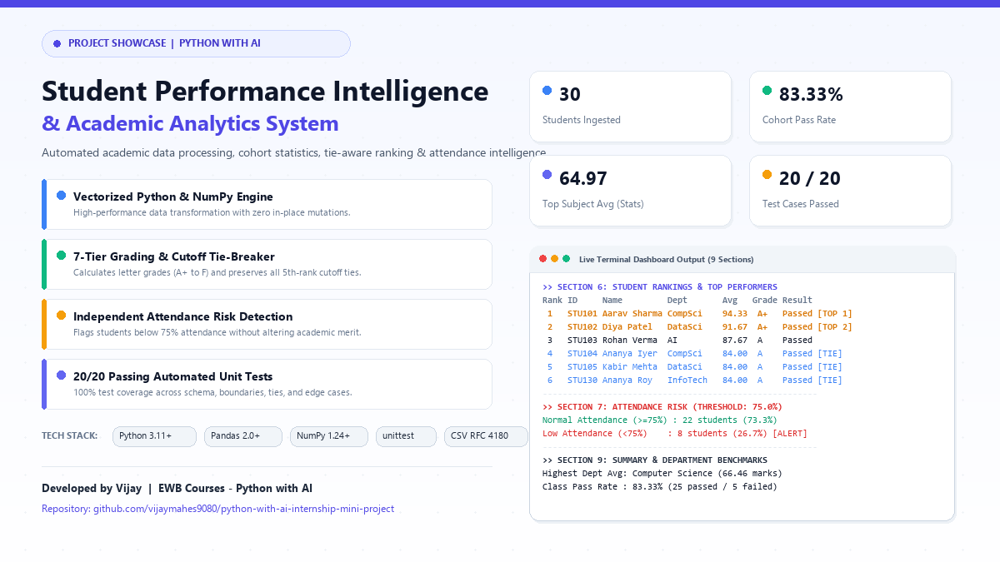

<div align="center">

# 🎓 Student Performance Intelligence and Academic Analytics

<p align="center">
  <strong>An End-to-End Automated Academic Data Pipeline, Statistical Evaluation Engine & Executive Decision Dashboard</strong>
</p>

[](https://www.python.org/)
[](https://pandas.pydata.org/)
[](https://numpy.org/)
[](https://github.com/vijaymahes9080/python-with-ai-internship-mini-project)
[](LICENSE)

<br/>



</div>

<br/>

## 📌 Executive Summary

The **Student Performance Intelligence and Academic Analytics** system is a production-ready, functional data analytics pipeline built for **EWB Courses | Python with AI**. 

In conventional academic institutions, examination scorecards and attendance logs are typically siloed across fragmented spreadsheets. This leads to manual calculation errors, flawed tie-breaking during student ranking, and delayed academic interventions. This project replaces that fragile workflow with a **reproducible, strictly validated, and immutable Python pipeline** that processes raw student records, evaluates subject mastery, computes statistical distributions with NumPy, detects attendance risks, and generates an executive 9-section terminal intelligence dashboard.

---

## ⚡ Key Project Metrics at a Glance

| Metric | Recorded Value | Evaluation Criteria |
|:---|:---:|:---|
| **Cohort Size** | **30 Students** | Synthetic educational records across 4 departments and 4 semesters |
| **Overall Class Pass Rate** | **83.33%** | 25 students passed all subjects; 5 students failed $\ge 1$ subject |
| **Cohort Mean Score** | **63.57 marks** | Median: 63.17 \| Population Std Dev ($\sigma$): 18.30 |
| **Top Performing Subject** | **Statistics (64.97)** | Pass rate: 93.33% \| Mean: 64.97 \| Median: 67.00 |
| **Top Academic Department** | **Computer Science (66.46)** | 8 students \| Highest department mean average score |
| **Attendance Action Roster** | **8 Students (26.7%)** | Flagged below the 75.0% institutional attendance threshold |
| **Automated Test Coverage** | **20 / 20 Scenarios (100%)** | Zero regressions across boundaries, ties, and schema failures |

---

## 🏗️ System Architecture & Data Flow

The system adheres to a **pure functional design pattern** where raw DataFrames are never mutated in-place. Every analytical transformation produces an isolated, validated copy.

<div align="center">
  
</div>

### Seven Pipeline Execution Stages:
1. **Data Ingestion (`data/students.csv`)**: Reads RFC 4180 standard CSV files with robust file existence and UTF-8 encoding verification.
2. **Strict Schema & Bounds Validation**: Enforces column presence, non-null entries, unique `STUxxx` primary keys, positive integer semesters, and bounded scores `[0.0, 100.0]`.
3. **High-Performance Vectorization**: Computes total marks, unweighted 3-subject averages, subject pass/fail states, and cohort distributions using NumPy vector operations.
4. **7-Tier Letter Grading Engine**: Translates student averages into standard academic marks (`A+` down to `F`) according to institutional grading brackets.
5. **Fair, Tie-Aware Ranking Algorithm**: Orders students using multi-tier sorting (Average descending $\rightarrow$ Student ID ascending) and preserves all tied students at the 5th-rank cutoff.
6. **Independent Attendance Risk Profiling**: Evaluates attendance compliance against the 75% threshold without distorting academic merit evaluations.
7. **Executive Dashboard & Automated Reporting**: Synthesizes 9 terminal intelligence modules, cross-group comparative matrices, and automated statistical commentary.

---

## 📊 Visual Analytics & Performance Benchmarks

The pipeline integrates automated visual reporting powered by Matplotlib, presenting multi-dimensional insights across subjects, departments, grades, and attendance correlations.

<div align="center">
  
</div>

### Analytical Findings Breakdown:
* **Subject Performance**: Statistics achieved the highest average (**64.97**) and highest pass rate (**93.33%**), while Python and Mathematics both recorded an identical average of **62.87** and a **90.00%** pass rate.
* **Departmental Hierarchy**: Computer Science recorded the top mean score (**66.46**), closely followed by Information Technology (**65.76**), Artificial Intelligence (**64.76**), and Data Science (**57.71**).
* **Grade Distribution**: Letter grades exhibit a natural Gaussian-style academic distribution: `A+` (2), `A` (6), `B` (5), `C` (4), `D` (5), `E` (7), `F` (1).
* **Attendance Risk Correlation**: Attendance issues are distributed across performance tiers—even high-performing students (e.g., `STU107` at 79.00% average) can fall below 75% attendance, highlighting the importance of evaluating attendance independently of academic grades.

---

## 💻 Terminal Intelligence Dashboard

The application runs directly in any terminal or PowerShell console, generating a structured, high-legibility report with zero external heavy UI dependencies.

<div align="center">
  
</div>

### 9 Core Dashboard Modules:
1. **Section 1: Project Metadata & System Integrity** – Environment parameters, dataset location, and synthetic disclaimer.
2. **Section 2: Raw Dataset Inspection** – Row/column counts, missing value audit, and sample head records.
3. **Section 3: Comprehensive Student Master Roster** – ID, Student Name, Department, Subject Marks, Total, Average, Grade, Result, and Attendance.
4. **Section 4: Subject Performance Matrix** – Mean, median, highest, lowest, standard deviation, pass/fail counts, and top subject indicator.
5. **Section 5: Cohort-Wide Statistical Benchmarks** – Class pass rate, distribution metrics, and class attendance average.
6. **Section 6: Student Rankings & Cutoff Preservation** – Ranked top performers (preserving all ties at rank 5) and lowest-performing student roster.
7. **Section 7: Attendance Compliance Roster** – Detailed roster of students flagged for mandatory academic counseling (< 75.0%).
8. **Section 8: Group Comparisons** – Department-wise and semester-wise aggregated benchmarks.
9. **Section 9: Automated Statistical Findings** – Factual, automated summaries formulated directly from processed metrics.

---

## 📐 Dataset Schema & Grading Rules

### Dataset Schema (`data/students.csv`)
| Column Name | Type | Allowed Range | Description |
|---|:---:|:---:|---|
| `student_id` | String | Format `STUxxx` | Unique primary identifier |
| `student_name` | String | Non-empty | Student full name |
| `department` | String | Categorical | Academic department |
| `semester` | Integer | Positive integer | Enrolled semester ($1 \le s \le 4$) |
| `python_marks` | Numeric | 0.0 – 100.0 | Python Programming score |
| `mathematics_marks` | Numeric | 0.0 – 100.0 | Applied Mathematics score |
| `statistics_marks` | Numeric | 0.0 – 100.0 | Probability & Statistics score |
| `attendance_percentage` | Numeric | 0.0 – 100.0 | Lecture attendance compliance |

### Academic Grading Scale
| 3-Subject Average | Letter Grade | Academic Standing |
|:---:|:---:|---|
| $90.0 \le \text{Average} \le 100.0$ | **A+** | Outstanding Distinction |
| $80.0 \le \text{Average} < 90.0$ | **A** | Excellent |
| $70.0 \le \text{Average} < 80.0$ | **B** | Very Good |
| $60.0 \le \text{Average} < 70.0$ | **C** | Good |
| $50.0 \le \text{Average} < 60.0$ | **D** | Satisfactory |
| $35.0 \le \text{Average} < 50.0$ | **E** | Conditional Pass |
| $\text{Average} < 35.0$ | **F** | Academic Failure |

> **Pass Criteria**: An individual passes if and only if **every** subject score is $\ge 35.0$. A score $< 35.0$ in any single subject results in an overall status of **"Failed"**.

---

## 🧪 Automated Testing & Verification

The test suite contains **20 unit tests** written using the standard library `unittest` module, covering every boundary, calculation, and error branch.

```powershell
python -m unittest discover -s tests -v
```

### Test Suite Matrix:
| Test ID | Test Scenario | Verification Objective |
|:---:|---|---|
| `test_01` | `test_grade_boundaries` | Verifies exact transitions for all 7 grade brackets (`A+` to `F`) |
| `test_02` | `test_marks_exactly_at_passing_threshold` | Verifies boundary score of exactly `35.0` $\implies$ Pass |
| `test_03` | `test_marks_below_passing_threshold` | Verifies `34.99` and `0.0` boundary scores $\implies$ Fail |
| `test_04` | `test_total_and_average_calculations` | Verifies vector mathematical precision of totals and means |
| `test_05` | `test_subject_pass_fail_determination` | Verifies subject-level boolean evaluation |
| `test_06` | `test_overall_pass_fail_determination` | Verifies multi-subject conjunction (all must pass) |
| `test_07` | `test_attendance_exactly_at_75_percent` | Verifies boundary `75.0%` attendance $\implies$ Normal |
| `test_08` | `test_attendance_below_75_percent` | Verifies boundary `74.9%` attendance $\implies$ Low Attendance |
| `test_09` | `test_subject_averages` | Validates subject averages against NumPy baseline |
| `test_10` | `test_class_average` | Validates class mean across all student averages |
| `test_11` | `test_pass_percentage` | Validates cohort pass rate calculation and zero-division guard |
| `test_12` | `test_top_five_ranking` | Confirms strict descending order and student ID tie-breaking |
| `test_13` | `test_tied_student_averages_and_cutoff` | Confirms preservation of all tied students at rank 5 |
| `test_14` | `test_empty_datasets` | Rejects empty DataFrames with `ValueError` |
| `test_15` | `test_duplicate_ids` | Rejects duplicate student IDs with `ValueError` |
| `test_16` | `test_missing_columns` | Rejects missing schema fields with `ValueError` |
| `test_17` | `test_invalid_marks` | Rejects negative scores or scores $> 100.0$ |
| `test_18` | `test_invalid_attendance` | Rejects attendance percentages $< 0.0$ or $> 100.0$ |
| `test_19` | `test_invalid_semester_values` | Rejects non-integer or negative semester values |
| `test_20` | `test_missing_or_empty_csv_input` | Rejects invalid or nonexistent file paths |

---

## 🚀 Installation & Quickstart (Windows PowerShell)

### 1. Clone the Repository
```powershell
git clone https://github.com/vijaymahes9080/python-with-ai-internship-mini-project.git
cd python-with-ai-internship-mini-project
```

### 2. Create and Activate Virtual Environment
```powershell
python -m venv .venv
.venv\Scripts\Activate.ps1
```

### 3. Install Dependencies
```powershell
python -m pip install --upgrade pip
python -m pip install -r requirements.txt
```

### 4. Execute the Application
```powershell
python main.py
```

### 5. Run the Automated Unit Tests
```powershell
python -m unittest discover -s tests -v
```

---

## 📁 Repository Structure

```text
python-with-ai-internship-mini-project/
├── data/
│   └── students.csv                # Synthetic educational dataset (30 records)
├── tests/
│   └── test_functions.py           # 20 automated unit test scenarios (unittest)
├── reports/
│   └── README.md                   # Guide for report generation and exports
├── screenshots/
│   ├── README.md                   # Visual assets documentation
│   ├── banner_light.png            # Light theme hero header banner
│   ├── pipeline_architecture.png   # 7-stage architecture & data flow diagram
│   ├── analytics_charts.png        # 4-panel Matplotlib academic distribution charts
│   ├── terminal_dashboard_preview.png # Light terminal execution window mockup
│   └── linkedin_showcase.png       # High-impact LinkedIn post showcase visual
├── functions.py                    # Modular, pure functional analytics & validation engine
├── main.py                         # Application entrypoint & 9-section CLI dashboard
├── generate_assets.py              # Automated asset generator for visual documentation
├── requirements.txt                # Production dependencies (pandas, numpy, matplotlib, pillow)
├── .gitignore                      # Comprehensive Git exclusion rules
├── LICENSE                         # Official MIT Open Source License
├── Project_Documentation.md        # Comprehensive 10-section EWB coursework submission
├── LINKEDIN_POST.md                # Ready-to-publish LinkedIn post copy & formatting
├── image.png                       # Dedicated root-level LinkedIn showcase visual
└── README.md                       # Repository master documentation
```

---

## 🌐 LinkedIn Showcase

A dedicated high-resolution visual (`image.png`) and ready-to-publish launch copy have been prepared for sharing this project on LinkedIn.

<div align="center">
  
</div>

👉 Check [LINKEDIN_POST.md](LINKEDIN_POST.md) for the complete copy-paste post text, key talking points, and hashtags!

---

## 📜 License

This project is licensed under the **MIT License** — see the [LICENSE](LICENSE) file for complete details.

---

## 👨‍💻 Author & Acknowledgements

* **Developer**: **Vijay**
* **Curriculum**: **EWB Courses | Python with AI**
* **Coursework**: Individual End-to-End Course Project (October 2026)
* **GitHub Repository**: [@vijaymahes9080/python-with-ai-internship-mini-project](https://github.com/vijaymahes9080/python-with-ai-internship-mini-project)

<div align="center">
  <sub>Built with clean code, pure functions, and mathematical precision for academic decision intelligence.</sub>
</div>
